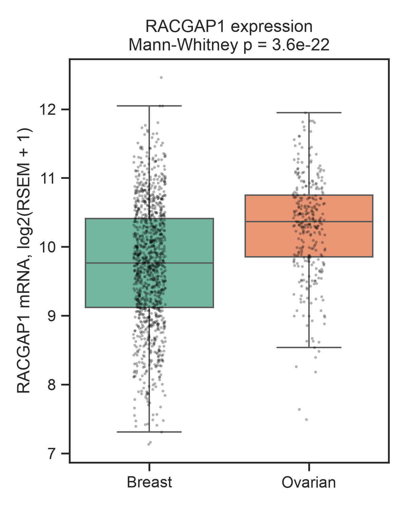
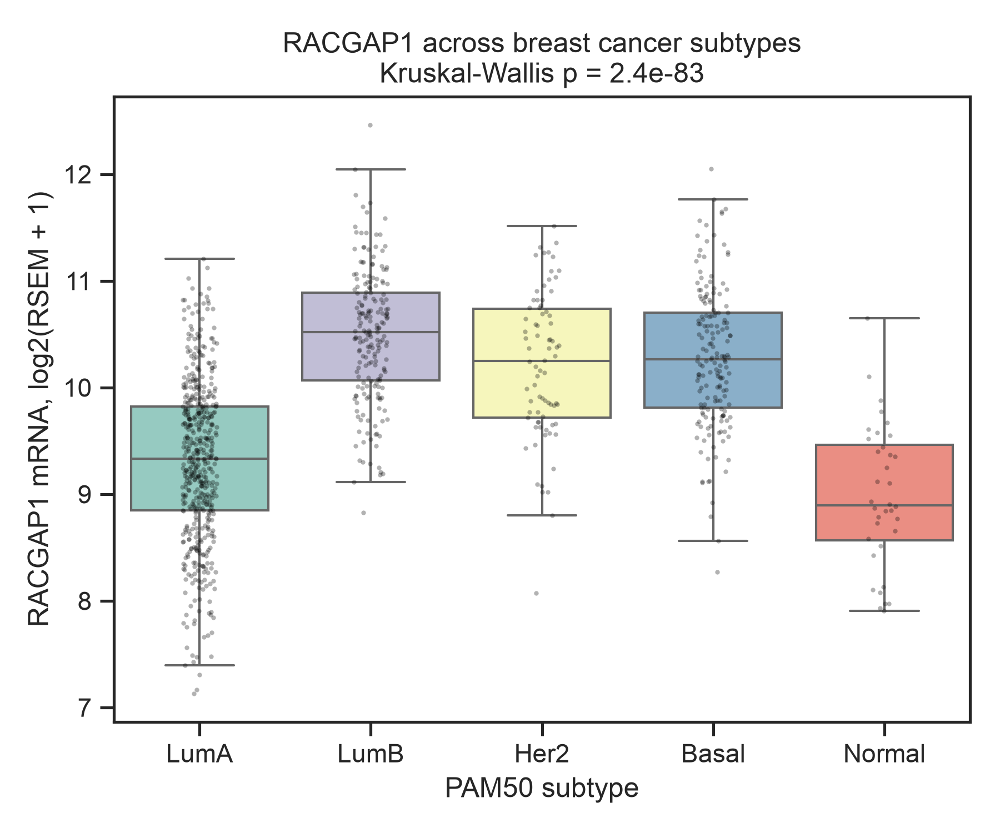
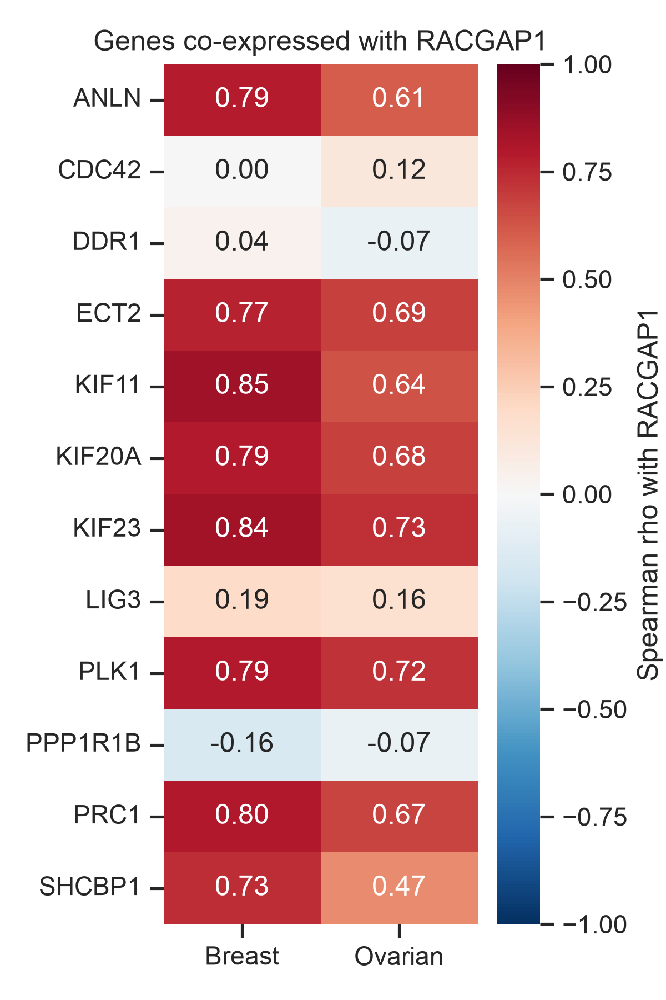
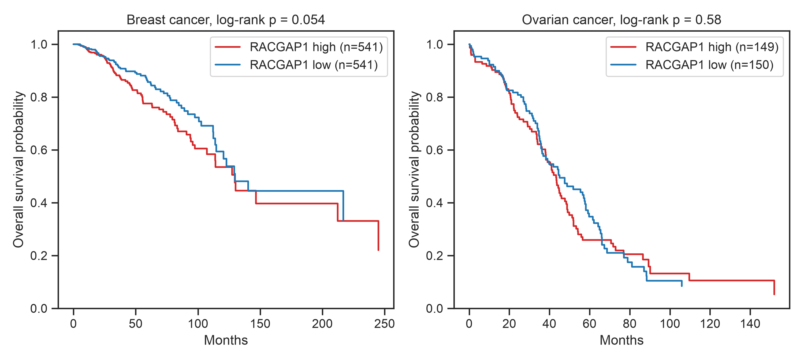

# RACGAP1 in Breast and Ovarian Cancer: a TCGA Analysis in Python

An analysis of RACGAP1 gene expression in 1,082 breast and 300 ovarian tumours from The Cancer Genome Atlas (TCGA). It links to my undergraduate dissertation on proteins linked with DDR1 in breast and ovarian cancer, where RACGAP1 is my biomarker of interest.

## Background
RACGAP1 is a protein that helps cells split in two at the end of cell division (cytokinesis). It works with KIF23 and ECT2. High RACGAP1 has been linked to more aggressive cancers. In my dissertation (University of Nottingham) I study RACGAP1 and DDR1 protein in patient samples using Western blotting and immunohistochemistry. This project asks what large public patient datasets show.

## Questions
1. Is RACGAP1 different between breast and ovarian tumours?
2. Is it different between breast cancer subtypes?
3. Which genes rise and fall with RACGAP1, including DDR1?
4. Is RACGAP1 linked to survival?

## Data
- **Source:** TCGA PanCancer Atlas, downloaded with the [cBioPortal](https://www.cbioportal.org) API (`brca_tcga_pan_can_atlas_2018`, `ov_tcga_pan_can_atlas_2018`).
- **Expression:** RNA sequencing (RSEM), log2-transformed. One tumour per patient.
- **Clinical:** breast cancer subtype (PAM50), survival time and status.
- **Genes:** RACGAP1, DDR1, PPP1R1B, LIG3, KIF23, SHCBP1, PLK1, KIF11, ECT2, CDC42, ANLN, PRC1, KIF20A.

## Methods
- Downloading and cleaning data: `requests`, `pandas`
- Comparing groups: Mann-Whitney U and Kruskal-Wallis tests (`scipy`)
- Co-expression: Spearman correlation (`scipy`)
- Survival: median split, Kaplan-Meier curves and log-rank test (`statsmodels`)
- Figures: `matplotlib`, `seaborn`

## Key results
| Figure | Finding |
|---|---|
|  | RACGAP1 was higher in ovarian than breast tumours (median 10.37 vs 9.77, p = 3.6 × 10⁻²²). |
|  | RACGAP1 was highest in the fast-growing subtypes (Luminal B, Basal-like, HER2) and lowest in Luminal A and Normal-like (p = 2.4 × 10⁻⁸³). |
|  | RACGAP1 rose and fell strongly with cell-division genes such as KIF11, KIF23 and PRC1 (rho up to 0.85), but not with DDR1 (rho = 0.04 breast, -0.07 ovarian). |
|  | High RACGAP1 showed a non-significant trend towards poorer survival in breast cancer (p = 0.054) and no difference in ovarian cancer (p = 0.58). |

## Limitations
- RNA levels do not always match protein levels or activity.
- RACGAP1 rises with cell division, so some results may reflect how fast tumours grow.
- Each sample mixes cancer, normal and immune cells.
- The median cut point is arbitrary.
- Survival was not adjusted for stage, age or subtype.

## Next steps
- Compare with my protein results from Western blotting and immunohistochemistry.
- Adjust survival for stage, age and subtype using a Cox regression model.

## How to run
1. Install [Anaconda](https://www.anaconda.com/download), or run `pip install -r requirements.txt`.
2. Download this repository and open `racgap1_analysis.ipynb` in Jupyter.
3. Click **Run All**. The data downloads automatically into `data/`, and figures are saved in `figures/`.

## Acknowledgements
Data from The Cancer Genome Atlas (TCGA) Research Network, accessed through cBioPortal (Cerami et al., *Cancer Discovery* 2012; Gao et al., *Science Signaling* 2013).

## Author
Javan Boot, MSci Cancer Sciences, University of Nottingham
